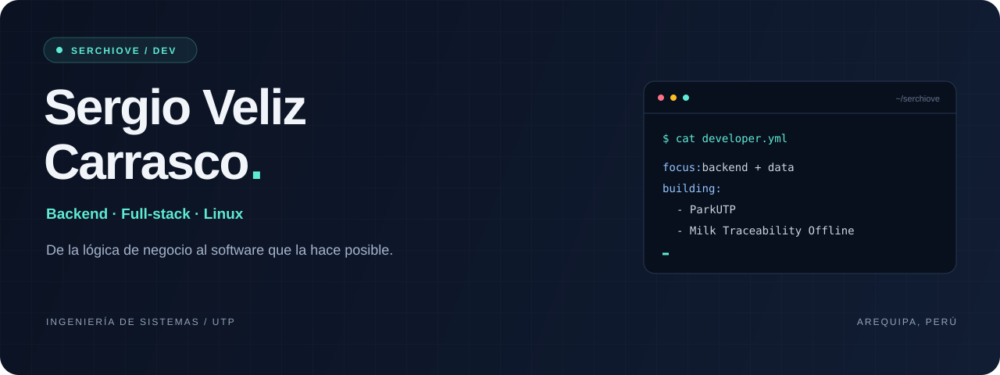
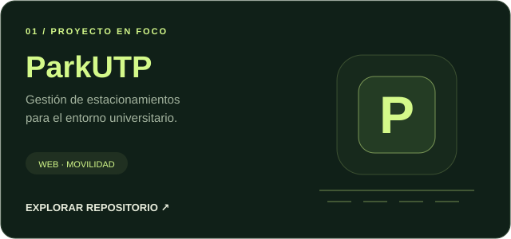
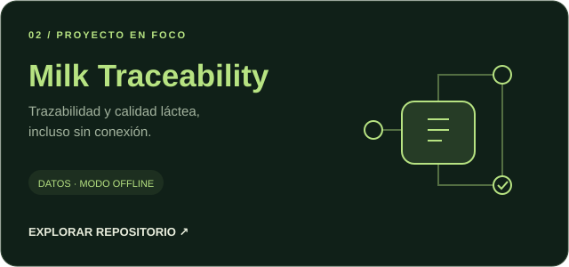
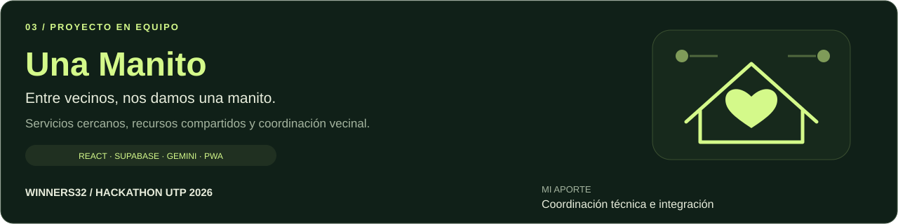
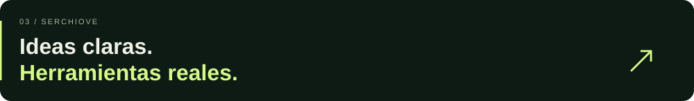
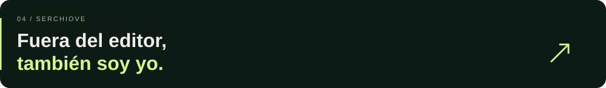

  

<a href="#sobre-mi">Sobre mí</a> &nbsp; · &nbsp;
<a href="#proyectos">Proyectos</a> &nbsp; · &nbsp;
<a href="#stack">Stack</a> &nbsp; · &nbsp;
<a href="#fuera-del-editor">Fuera del editor</a> &nbsp; · &nbsp;
<a href="#contacto">Contacto</a>

  

**Software para conectar datos, negocio y operaciones.**

Backend como punto de partida. Curiosidad por todo lo que lo rodea.

 

<h2></h2>

Soy **Sergio**, estudiante de **Ingeniería de Sistemas en la UTP, Arequipa**. Me interesa convertir procesos reales en aplicaciones claras: entender el negocio, modelar sus datos y construir la lógica que lo sostiene.

Mi enfoque combina **backend, arquitectura de software y bases de datos** con una visión analítica de la logística y la distribución. También exploro el desarrollo full-stack, las soluciones SaaS y los entornos Linux.

> **Ahora estoy construyendo:** ParkUTP, Milk Traceability Offline y **Una Manito con Winners32** — movilidad universitaria, trazabilidad láctea y colaboración vecinal.

 

<h2></h2>

  

**[Probar Una Manito ↗](https://una-manito-app.vercel.app/)** &nbsp; · &nbsp; **[Ver el repositorio del equipo ↗](https://github.com/Melissa-1217/una-manito-app)**

  

### Más problemas, más formas de construir

| Proyecto | Qué exploro | Área |
| :--- | :--- | :--- |
| **[Velcar](https://github.com/serchiove/velcar-ecommerce-platform)** | Comercio electrónico conectado con logística y distribución. | E-Commerce |
| **[BusTrack](https://github.com/serchiove/BusTrack)** | Digitalización de rutas de transporte en Arequipa. | Next.js · MVP |
| **[UTP-Marketplace](https://github.com/serchiove/UTP-Marketplace)** | Una API REST para un marketplace con persistencia relacional. | Java · Spring Boot · PostgreSQL |
| **[Python Report Generator](https://github.com/serchiove/python-report-generator)** | Extracción de datos y generación dinámica de reportes. | Python · Automatización |
| **[Tiros Libres 3D](https://github.com/serchiove/Simulador-Tiros-Libres-3D)** | Física y efecto Magnus llevados a una simulación web. | Física · Web · 3D |
| **[GameFlow Simulator](https://github.com/serchiove/GameFlow-Simulator)** | Desarrollo de interfaces gráficas de escritorio. | Java · Swing |

 

<h2></h2>

<table>
<tr>
<td width="50%" valign="top">
<h3>Backend &amp; datos</h3>

Lógica de negocio, APIs y persistencia.

Java · Spring Boot · Python · PostgreSQL · MySQL

</td>
<td width="50%" valign="top">
<h3>Frontend</h3>

Interfaces que conectan con el backend.

TypeScript · JavaScript · Next.js · Angular

</td>
</tr>
<tr>
<td valign="top">
<h3>Sistemas &amp; herramientas</h3>

El entorno donde todo toma forma.

Linux · Ubuntu · Git

</td>
<td valign="top">
<h3>Laboratorio personal</h3>

Experimentar también es parte del proceso.

<code>Minecraft Forge</code> <code>Modding</code>

<code>Simulación física</code> <code>Java Swing</code>

</td>
</tr>
</table>

 

<h2></h2>

No todo pasa en la terminal.

- **En mis audífonos:** rock en español, alternativo, pop punk y reggae clásico.
- **En mis partidas:** FPS tácticos, MOBAs, sandbox y modding.
- **En la cancha:** Real Madrid y Fede Valverde. ¡Hala Madrid!
- **Junto al teclado:** Chocho, mi gato tuxedo y compañero de programación. 🐈‍⬛

 
 

---

 

<h2></h2>

Conversemos sobre desarrollo, tecnología o lo que estás construyendo.

  

[Instagram](https://www.instagram.com/checho_velizz/) &nbsp; / &nbsp; [Steam](https://steamcommunity.com/profiles/76561199044780477/) &nbsp; / &nbsp; [Facebook](https://www.facebook.com/sergio.veliz.77128/) &nbsp; / &nbsp; [Actividad en GitHub](https://github.com/serchiove?tab=overview)

 

AREQUIPA, PERÚ &nbsp; · &nbsp; SERCHIOVE

